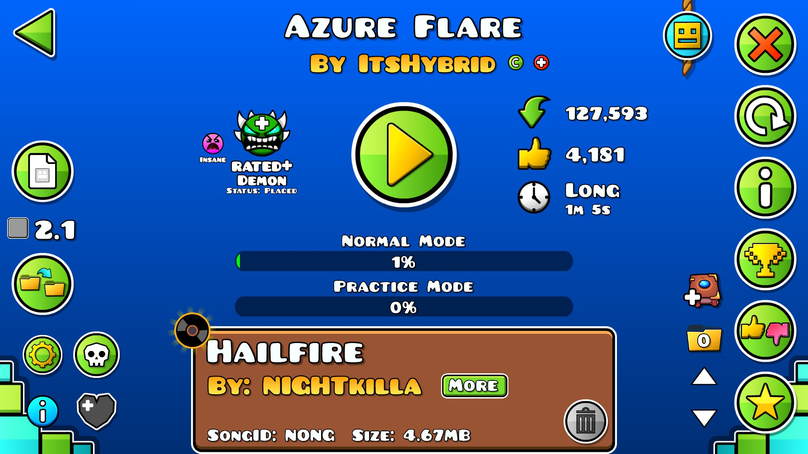
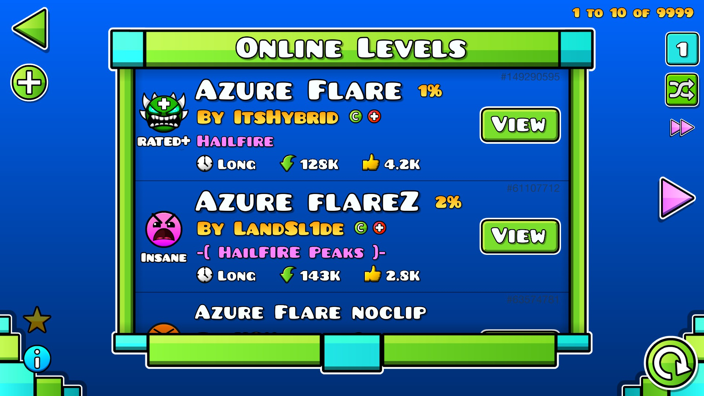
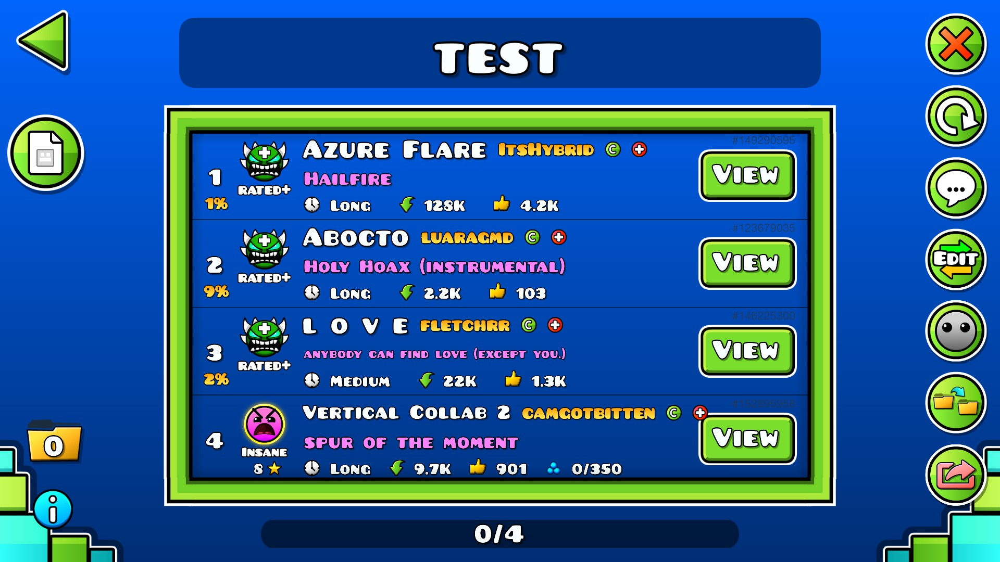

# RatedPlusDemon

### THIS MOD IS NOT AFFILIATED WITH POINTERCRATE

Adds in a new pseudo-difficulty to represent unrated levels on the Pointercrate Rated+ Demonlist for a (mostly) cosmetic and a semi-functional purpose.
Adds the difficulty in question to LevelInfoLayer and LevelCell.
Displays the server difficulty and placement status around the demon.

